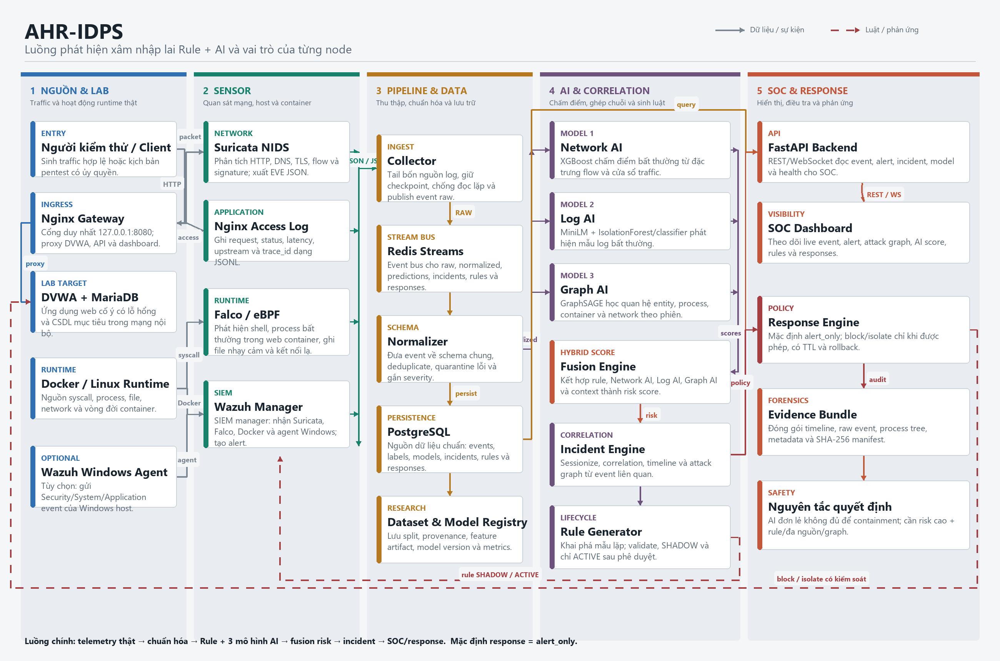
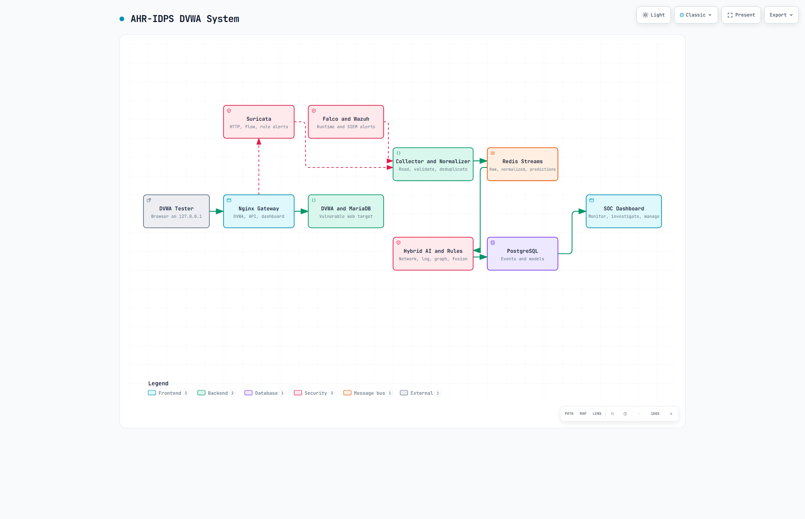

# AHR-IDPS

Đã train Colab và có `dist/ahr-models-v2.zip`: xem
[cài bundle v2, chạy AI local và graph 20 request](docs/USE_COLAB_MODEL_BUNDLE.md).

Notebook Colab L4 cho hệ thống AI legacy: [hướng dẫn](docs/COLAB_AI_GUIDE.md),
[notebook](notebooks/AHR_IDPS_L4_Training.ipynb). Colab v2 dùng bộ scorer và bridge
có version riêng; không ghi đè mù các artifact cũ. Bản LLM vẫn riêng ở llm-system/.

**Adaptive Hybrid Rule-AI Intrusion Detection and Prevention System**

> Runbook hiện hành bằng tiếng Việt: [kiểm thử, giám sát và pentest có kiểm
> soát](HUONG_DAN_KIEM_THU_GIAM_SAT_PENTEST.md). Cây mã nguồn hiện có acceptance
> gate đến Phase 14; phần mô tả Phase 2 bên dưới là mốc bàn giao lịch sử.

Giải thích node, giao diện quản trị và quy trình giám sát: [docs/ahr-idps-node-functions.md](docs/ahr-idps-node-functions.md).

Workflow script ổn định cho lab nhỏ: [SCRIPTS_README_V2.md](SCRIPTS_README_V2.md).

Dataset và quy trình train cho DVWA: [docs/dataset_training_guide.md](docs/dataset_training_guide.md).

Phân tích GenTI và phần tích hợp CoVe/CTI vào Rule Engine: [docs/paper_genti_analysis.md](docs/paper_genti_analysis.md). Sơ đồ vòng đời rule theo GenTI-lite: [docs/visuals/genti-ahr-idps.workflow.html](docs/visuals/genti-ahr-idps.workflow.html).

Train và so sánh Network AI từ CSV/ZIP Kaggle: [docs/kaggle_dataset_and_training.md](docs/kaggle_dataset_and_training.md).

Wazuh manager API tùy chọn được mở loopback bằng `bash ./scripts/start_wazuh_api.sh`;
dashboard quản trị dùng mục **Wazuh Manager** và địa chỉ `https://127.0.0.1:55000`.

Mốc bàn giao lịch sử: **Phase 2 — Sensors**. Phase 1 dựng lab DVWA thật và đã
có acceptance gate độc lập. Phase 2 bổ sung Suricata, Falco và Wazuh manager;
các acceptance script chỉ đạt khi đọc được sự kiện thật do traffic, syscall và
Docker lifecycle probe tạo ra. Collector/normalizer, dashboard, dataset, AI,
correlation, sinh luật và active response của Phase 3+ vẫn bị khóa đúng lộ
trình; project không tạo alert, metric hay kết quả mô hình giả.

> Cảnh báo: DVWA cố ý chứa lỗ hổng bảo mật. Chỉ chạy project này trên máy lab.
> Không đổi các bind loopback thành `0.0.0.0` hoặc địa chỉ LAN/public.

## Architecture






```text
Controlled client
      |
127.0.0.1:8080
      |
    Nginx ---------------- Suricata (shares Nginx network namespace)
      |                                  |
internal dvwa_front                 suricata_logs/EVE JSON
      |                                  |
    DVWA                                  +-------------------+
      |                                                       |
internal dvwa_db       Linux syscalls --- Falco/eBPF           |
      |                                      |                 v
  MariaDB                              falco_events/JSONL --> Wazuh manager
                                                               ^
Docker Engine lifecycle ---------------- Docker socket --------+

Optional native Windows agent -- 127.0.0.1:1514/1515 ----------+

PostgreSQL -------- internal data -------- Redis
```

Suricata quan sát hai chân traffic thật trong network namespace của Nginx:
loopback/ingress đến Nginx và proxy từ Nginx đến DVWA. Falco đọc syscall của
Linux kernel bằng modern eBPF. Wazuh đọc hai named volume ở chế độ read-only và
phân tích Docker events; nó lưu JSON alert thật cục bộ mà không cần indexer hay
dashboard.

### Network và port policy

| Scope | Cấu hình | Host port |
| --- | --- | --- |
| Phase 1 ingress | Nginx là thành viên duy nhất của `ingress` | `127.0.0.1:${LAB_HTTP_PORT}->80` |
| DVWA frontend | `dvwa_front`, `internal: true` | none |
| DVWA database | `dvwa_db`, `internal: true` | none |
| Data services | `data`, `internal: true` | none |
| Suricata | `network_mode: service:nginx` | none |
| Falco | `network_mode: none`, host PID chỉ để quan sát syscall | none |
| Wazuh agent transport | dedicated `wazuh_agent` bridge | `127.0.0.1:1514/tcp` |
| Wazuh enrollment | password-protected, manager-only overlay | `127.0.0.1:1515/tcp` |

MariaDB, PostgreSQL, Redis và DVWA không publish port. Wazuh API, indexer và
dashboard không được include hoặc publish. Hai port Wazuh chỉ phục vụ native
agent trên chính host; khi chỉ chạy Phase 1, Nginx vẫn là port publish duy nhất.

## File tree đã triển khai

```text
ahr-idps/
├── docker-compose.yml                 # Phase 1 core lab
├── .env.example
├── Makefile
├── README.md
├── infrastructure/
│   ├── dvwa/README.md
│   ├── mariadb/conf.d/ahr.cnf
│   ├── networks/README.md
│   ├── nginx/nginx.conf
│   ├── postgres/init/01-init-ahr.sh
│   └── redis/{redis.conf,redis-entrypoint.sh}
├── sensors/
│   ├── suricata/
│   │   ├── compose.fragment.yml
│   │   ├── suricata.yaml
│   │   ├── rules/{base.rules,generated.rules,shadow.rules}
│   │   └── scripts/suricata-entrypoint.sh
│   ├── falco/
│   │   ├── compose.fragment.yml
│   │   ├── 90-ahr-idps.yaml
│   │   ├── falco_rules.local.yaml
│   │   └── generated_rules.yaml
│   └── wazuh/
│       ├── compose.fragment.yml
│       ├── manager/ossec.conf
│       ├── rules/ahr_falco_rules.xml
│       ├── entrypoint-scripts/10-manager-only.sh
│       └── secrets/authd.pass          # generated locally, gitignored
├── scripts/
│   ├── lib/{common.sh,sensors.sh}
│   ├── start_lab.sh / stop_lab.sh / init_dvwa.sh
│   ├── start_sensors.sh / stop_sensors.sh
│   ├── verify_phase1.sh / verify_phase2.sh
│   ├── rotate_lab_secrets.sh
│   ├── suricata_acceptance.sh
│   ├── falco_acceptance.sh
│   ├── wazuh_acceptance.sh
│   ├── wazuh_prepare.sh
│   └── wazuh_auth_probe.ps1
├── collector/                         # reserved for Phase 3
├── normalizer/                        # reserved for Phase 3
├── dashboard/                         # reserved for Phase 4
├── datasets/                          # reserved for Phase 5
├── feature_engine/ and ai/            # reserved for Phase 6+
├── correlation/                       # reserved for Phase 10
├── rule_engine/                       # reserved for Phase 11+
├── response/                          # reserved for Phase 13
└── experiments/                       # reserved for Phase 14
```

Mỗi sensor nằm trong một Compose fragment để Phase 1 vẫn test độc lập. Script
`scripts/lib/sensors.sh` luôn merge ba fragment theo cùng một thứ tự, tránh
drift giữa start, status và acceptance.

## Requirements

- Docker Engine 28+ ở Linux-container mode.
- Docker Compose 2.26+; lifecycle dùng `up --wait` và long-form port metadata.
- Bash 4+, `curl`; GNU Make là tùy chọn.
- Khuyến nghị tối thiểu 4 CPU, 8 GB RAM và 10 GB disk trống cho Phase 1+2.
- Falco modern eBPF cần Linux kernel có BTF và BPF ring buffers (thông thường
  Linux 5.8+), host PID và các capability được khai báo trong fragment.
- Suricata live capture cần `NET_ADMIN`, `NET_RAW`, `SYS_NICE`; rootless
  Docker/Podman thường không cấp đủ capability.

Docker Engine 28+ được enforce vì các bản cũ có thể để host cùng layer-2 truy
cập port đã bind localhost. Xem cảnh báo
[Docker port publishing](https://docs.docker.com/engine/network/port-publishing/).

Trên Windows, bật Docker Desktop Linux containers và chạy script bằng Git Bash
hoặc WSL. Falco khi đó quan sát Linux VM/container của Docker Desktop, không
quan sát process Windows.

```powershell
& 'C:\Program Files\Git\bin\bash.exe' ./scripts/start_lab.sh
```

## Install

Từ thư mục `ahr-idps`:

```bash
make install
```

Không dùng Make:

```bash
bash ./scripts/start_lab.sh --install-only
bash ./scripts/start_sensors.sh --install-only
```

Install tạo `.env` nếu chưa có, thay mọi `CHANGE_ME_*` bằng secret ngẫu nhiên,
tạo enrollment secret Wazuh trong thư mục gitignored, validate Compose và kéo
các image đã pin digest. Script không ghi đè `.env` đang tồn tại.

Có thể cài từng lớp bằng `make phase1-install` hoặc `make phase2-install`.

## Start

Khởi động toàn bộ Phase 1+2 theo đúng health gate:

```bash
make start
```

Không dùng Make:

```bash
bash ./scripts/start_lab.sh
bash ./scripts/start_sensors.sh
```

`start_lab.sh` dựng core, chờ health và khởi tạo schema DVWA idempotent.
`start_sensors.sh` từ chối chạy nếu bất kỳ service Phase 1 nào chưa healthy,
khởi động Suricata/Falco trước rồi mới khởi động Wazuh để các file event đã tồn
tại khi localfile reader bắt đầu.

Workflow Compose trực tiếp cho phần core vẫn được hỗ trợ:

```bash
bash ./scripts/start_lab.sh --prepare-only
docker compose --env-file .env up -d --wait --wait-timeout 300
bash ./scripts/init_dvwa.sh
bash ./scripts/start_sensors.sh
```

Mở <http://127.0.0.1:8080>. Nếu đổi `LAB_HTTP_PORT` trong `.env`, dùng port đó.
Tài khoản upstream mặc định của DVWA là `admin` / `password`.

Các target `make phase1-start` và `make phase2-start` có sẵn cho thao tác tách
lớp; Phase 2 start vẫn yêu cầu core đang healthy.

## Stop

```bash
make stop
```

Không dùng Make:

```bash
bash ./scripts/stop_sensors.sh
bash ./scripts/stop_lab.sh
```

Sensor phải dừng trước core vì Suricata chia sẻ network namespace của Nginx.
Các script không dùng `-v`; database, EVE, Falco JSONL và Wazuh manager state
được giữ trong named volumes. `make phase2-stop` chỉ stop sensor. Khi đang chạy
cả stack, ưu tiên `make stop` thay vì dừng riêng Phase 1.

## Status và logs

```bash
make status
make logs

# Chỉ một lớp
make phase1-status
make phase2-status
make phase1-logs
make phase2-logs
```

Không dùng Make, merge cùng ba overlay:

```bash
docker compose --env-file .env \
  -f docker-compose.yml \
  -f sensors/suricata/compose.fragment.yml \
  -f sensors/falco/compose.fragment.yml \
  -f sensors/wazuh/compose.fragment.yml \
  ps --all

docker compose --env-file .env \
  -f docker-compose.yml \
  -f sensors/suricata/compose.fragment.yml \
  -f sensors/falco/compose.fragment.yml \
  -f sensors/wazuh/compose.fragment.yml \
  logs --follow --tail 200
```

Trạng thái chuẩn gồm tám service healthy: `nginx`, `dvwa`, `mariadb`,
`postgres`, `redis`, `suricata`, `falco`, `wazuh-manager`. Ngoài Nginx và hai
endpoint Wazuh bind loopback, không service nào được có published port.

## Verification và real-event acceptance

Static checks không cần container đang chạy:

```bash
make validate

# Hoặc chạy riêng
make phase1-validate
make phase2-validate
```

Full acceptance cần chạy `make start` trước:

```bash
make test
# Tương đương gate Phase 2 đầy đủ:
bash ./scripts/verify_phase2.sh
```

`verify_phase2.sh` chạy tuần tự ba probe sensor, sau đó chạy lại toàn bộ
`verify_phase1.sh`; vì vậy Phase 2 không thể PASS nếu làm regress isolation,
database, health hoặc port policy của core. Có thể chạy gate độc lập bằng:

```bash
make phase1-test
make phase2-test

bash ./scripts/suricata_acceptance.sh
bash ./scripts/falco_acceptance.sh
bash ./scripts/wazuh_acceptance.sh
```

Acceptance không append fixture vào log:

- **Phase 1:** kiểm tra năm service thật, network membership, loopback bind,
  Nginx/DVWA, schema/query MariaDB và PostgreSQL, Redis auth và DNS isolation.
- **Suricata:** gửi unique harmless URL qua Nginx và yêu cầu EVE có cả native
  `http` event lẫn `alert` SID `9000001`; cấu hình bật `alert`, `http`, `flow`,
  `dns`, `tls` nhưng không bịa TLS event khi traffic không có TLS.
- **Falco:** thực thi controlled syscalls trong DVWA và yêu cầu đủ sáu rule dự
  án: shell, unexpected child, executable trong `/tmp`, sensitive-path write,
  outbound connection và privilege activity; JSONL phải là native Falco event.
- **Wazuh:** tạo marker container, Suricata HTTP marker và Falco eBPF shell;
  yêu cầu alert mới tương ứng rule `87901`, `86601`, `100101` và mọi dòng hoàn
  chỉnh trong `alerts.json` phải parse được thành JSON.

Suricata có thể ghi hai HTTP record cho một logical request vì thấy cả ingress
và upstream leg. Đây là capture topology thật, không phải event trùng giả.

## Wazuh và native Windows agent

Container `wazuh-manager` **không thể giám sát Windows host**. Trên Docker
Desktop, mount host path Linux chỉ nhìn thấy VM của Docker; nó không tạo ra
Windows Security/System/Application events. Acceptance mặc định chỉ chứng minh
Docker + Suricata + Falco integration và tuyệt đối không claim host-auth
coverage.

Muốn thu Windows host/auth event, cài signed Wazuh 4.14.7 native agent trên
Windows, enroll vào `127.0.0.1:1515` bằng private value trong
`sensors/wazuh/secrets/authd.pass`, rồi gửi event về `127.0.0.1:1514`. Chi tiết
lệnh MSI nằm tại [sensors/wazuh/README.md](sensors/wazuh/README.md).

Sau khi native agent active, chạy strict gate:

```bash
bash ./scripts/wazuh_acceptance.sh --require-host-auth
```

Gate này tạo một controlled failed Windows logon với username không tồn tại và
chỉ PASS khi Wazuh nhận alert tương ứng từ agent không phải manager. Dùng
`--docker-only` để chẩn đoán riêng Docker listener.

## Security boundaries

- Tất cả image Phase 1+2 đều pin digest; version/scope cụ thể được ghi trong
  Compose và README của từng sensor.
- DVWA không có default gateway ra Internet. Suricata không dùng host network
  hoặc privileged mode.
- Falco cần host PID/tracefs. Docker socket mà Falco và Wazuh mount là trust
  boundary có quyền tương đương daemon, dù bind có hậu tố `:ro`; chỉ chạy sensor
  image đã pin trong lab tin cậy.
- Container environment vẫn có thể bị người có quyền Docker daemon inspect.
  Cấu hình hiện tại phù hợp single-host lab, không phải production secret
  management.
- Wazuh ở topology manager-only, resource cap 2 CPU/1.5 GiB. Không áp yêu cầu
  indexer `vm.max_map_count`; cũng không claim đã triển khai full Wazuh stack.

## Phase gates còn lại

- **Phase 3:** collector, schema normalizer, persisted event pipeline và API
  backend cơ bản.
- **Phase 4:** FastAPI/WebSocket/React dashboard dùng dữ liệu thật.
- **Phase 5:** traffic generation có kiểm soát, dataset và label provenance.
- **Phase 6+:** feature engineering, train/save/load/inference theo từng model.
- **Phase 10+:** correlation, candidate rules, validation/shadow/deploy và
  active response `alert_only` mặc định.
- **Phase 14:** ablation, unknown-attack và generated-rule before/after.

Các target sau cố ý trả non-zero thay vì tạo kết quả giả:

```bash
make collect    # gated until Phase 5
make train      # gated until Phase 6
make evaluate   # gated until Phase 14
```

Phase 2 không có inference, dashboard giả, generated-rule deployment hay hành
động thay đổi firewall/isolate/delete/restart container để response.

## Troubleshooting

### Docker Engine không reachable hoặc không phải Linux

```bash
docker version
docker info --format '{{.OSType}}'
```

Khởi động Docker Desktop/`dockerd`, chọn Linux containers rồi chạy lại install.

### Service unhealthy

```bash
make status
make logs
```

Kiểm tra riêng sensor bằng `make phase2-status` và `make phase2-logs`. Start
scripts tự in diagnostics sau khi health gate thất bại.

### Falco không nạp modern eBPF

Docker Desktop thường expose tracefs nguồn tại `/sys/kernel/debug/tracing`.
Native Linux có thể dùng `/sys/kernel/tracing`; chỉ đổi mount source, giữ
destination `/sys/kernel/tracing`. Rootless mode và Docker Desktop Enhanced
Container Isolation có thể chặn capability/host PID cần thiết.

### Wazuh không có Windows event

Đây là expected nếu chưa cài native Windows agent. Container manager không
thay thế host agent; xem mục **Wazuh và native Windows agent**.

### Port đã được sử dụng

Đổi `LAB_HTTP_PORT` trong `.env` cho Nginx. Hai port `1514`/`1515` là cố định,
loopback-only cho Wazuh agent; dừng service xung đột thay vì publish chúng ra
interface khác.

### DVWA credential thay đổi nhưng login lỗi

Biến initializer không xoay credential trong volume đã tồn tại. Xoay mật khẩu
trong database hoặc reset volume có chủ đích; chỉ sửa `.env` là chưa đủ. Khi
core đang healthy, `bash ./scripts/rotate_lab_secrets.sh` xoay đồng bộ cả năm
secret local, force-recreate các consumer cần thiết và chạy lại Phase 1 gate.

### Windows line endings

`.gitattributes` cố định shell script ở LF. Chạy bằng Git Bash hoặc WSL, không
dùng `cmd.exe`.

## Primary references

- [DVWA official repository](https://github.com/digininja/DVWA)
- [Docker Compose startup order](https://docs.docker.com/compose/how-tos/startup-order/)
- [Docker Compose networking](https://docs.docker.com/compose/how-tos/networking/)
- [Suricata 8.0.6 container security](https://docs.suricata.io/en/suricata-8.0.6/security.html#containers)
- [Suricata EVE JSON](https://docs.suricata.io/en/suricata-8.0.6/output/eve/eve-json-output.html)
- [Falco outputs](https://falco.org/docs/concepts/outputs/channels/)
- [Wazuh Docker monitoring](https://documentation.wazuh.com/current/user-manual/capabilities/container-security/monitoring-docker.html)
- [Wazuh Suricata integration](https://documentation.wazuh.com/current/proof-of-concept-guide/integrate-network-ids-suricata.html)
- [Wazuh Windows deployment variables](https://documentation.wazuh.com/current/user-manual/agent/agent-enrollment/deployment-variables/deployment-variables-windows.html)
