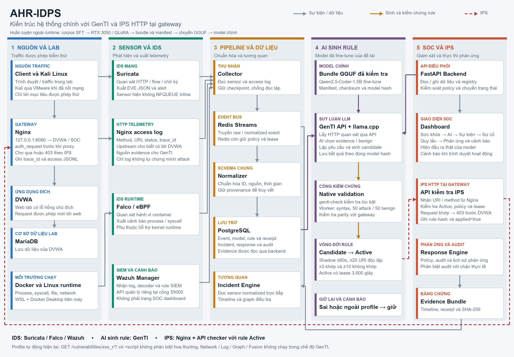
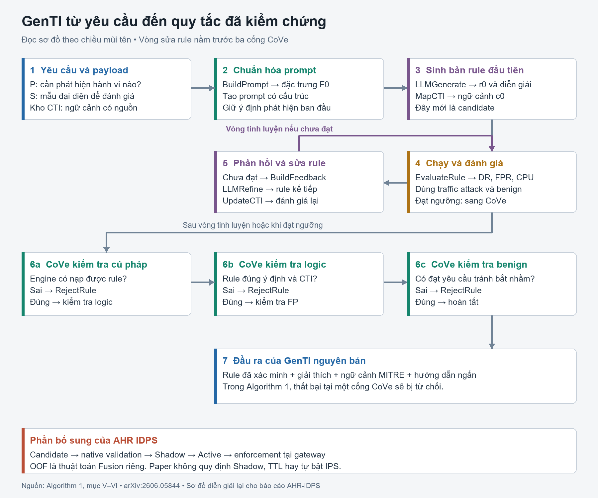

# AHR-IDPS

Hệ thống lab giám sát và bảo vệ DVWA, tích hợp cảm biến, pipeline sự kiện, SOC dashboard và LLM GenTI fine-tune để sinh quy tắc. Nhánh chính chứa mã vận hành hiện tại và báo cáo hoàn chỉnh.

## Vai trò trong hệ thống

| Thành phần | Công việc |
|---|---|
| Suricata, Falco, Wazuh | IDS: nhận diện và phát sự kiện/cảnh báo. |
| Collector, Normalizer, Redis, PostgreSQL | Thu thập, chuẩn hóa, truyền và lưu evidence. |
| Incident Engine | Tương quan sự kiện thành sự cố và graph điều tra. |
| GenTI | Dùng model fine-tune chính để chọn mẫu, lập yêu cầu và sinh candidate. |
| GenTI automation | Kiểm chứng native, theo dõi Shadow, cho Active khi đủ điều kiện và xử lý hết hạn. |
| Nginx và API kiểm tra IPS | Chặn request HTTP khớp rule Active trước khi chuyển đến DVWA. |
| Dashboard | Hiển thị sức khỏe, model, sự kiện, sự cố, quy tắc, phản ứng và cảnh báo. |

IPS hiện tự động trong profile GET `/vulnerabilities/xss_r/?...` có dấu hiệu `<script` sau chuẩn hóa. Rule ngoài profile được giữ lại và cảnh báo; chưa có Suricata NFQUEUE inline hay chặn toàn mạng. Trạng thái Active không thay cho evidence chặn thực tế: cần phản hồi gateway 403, rule hash và `applied=true`.

**Bộ luật nền đang nạp:** 33 Suricata, 41 Falco enabled, 31 luật AHR trong Wazuh. [Danh mục và kiểm chứng](docs/BASELINE_RULES.md). Đây là luật IDS nền, tách với candidate GenTI.

**Bản chính ngày 12/11/2026:** Qwen2.5-Coder-1.5B-Instruct fine-tune cục bộ, GGUF Q4_K_M. Toàn lượt train đã hoàn tất tập train; checkpoint stage 3 được chọn theo validation. Corpus gồm 50.000 prompt, trong đó 35.856 dòng train; không đồng nhất số prompt với số rule chuẩn khác nhau. Artifact runtime: `ecc4941e369a49a2833907a208029245e183708234ee2e21e4d18b3ddca96697`.

Lượt nghiệm thu model chính đạt 12 bước sinh rule → native → Shadow → Active → chặn gateway và 24 trường hợp method/encoding/phạm vi. Native 50 dương + 50 lành và các phép thử này là control tổng hợp, chưa phải DR/FPR độc lập. Dashboard đã đồng bộ **32 luật IDS nền vào Active**; cùng rule GenTI đang thực thi tại thời điểm nghiệm thu là 33 Active. Số Active thay đổi theo thời hạn của rule GenTI; xem cột **Thực thi IPS**, không dùng tổng Active làm số luật chặn.

## Tài liệu chính

- [Báo cáo hoàn chỉnh mới nhất](docs/reports/AHR-IDPS_Bao_Cao.docx): 7 chương, mỗi chương 5 mục; gồm GenTI gốc, OOF, dữ liệu huấn luyện và giới hạn kết quả.
- [Báo cáo PDF](docs/reports/AHR-IDPS_Bao_Cao.pdf).
- [Kết quả triển khai và kiểm chứng mới nhất](docs/LATEST_SYSTEM_RESULTS.md).
- [Toàn bộ thuật toán GenTI gốc](docs/GENTI_THUAT_TOAN_GOC.md).
- [Vận hành tự động và giải thích các màn hình](docs/GENTI_AUTOMATIC_IPS.md).
- [Khởi tạo Suricata, Falco, Wazuh và ảnh bộ luật có sẵn](docs/SENSOR_INITIALIZATION.md).
- [Paper GenTI gốc](https://arxiv.org/abs/2606.05844).

## Kiến trúc toàn bộ hệ thống



## Thuật toán GenTI



## Chuẩn bị trên Windows

Yêu cầu Docker Desktop Linux Engine, WSL `Ubuntu-24.04`, Node/npm để build dashboard và Python cho cài đặt model. Không đưa `.env`, mật khẩu, dữ liệu sự kiện, PCAP và trọng số model vào Git.

```powershell
git clone https://github.com/vynqan1122/GSANM-AHR-IDPS.git
cd GSANM-AHR-IDPS
npm.cmd --prefix dashboard ci
npm.cmd --prefix dashboard run typecheck
npm.cmd --prefix dashboard run build
```

Giữ `.env` đã có nếu tiếp tục môi trường hiện tại. Khi cài mới, script vận hành tạo từ `.env.example` và thay các placeholder bí mật. Chọn chế độ GenTI bằng `scripts/genti_control.ps1`; không cần bật lại các scorer Network/Log/Graph/Fusion để sinh rule.

## Nạp model đã fine-tune

Repo không chứa trọng số. Trên máy hiện tại, bundle đã chuyển đổi nằm ở `experiments/genti/main`, gồm `model.gguf`, `genti-manifest.json`, template và các file có checksum. Khi chuyển máy, sao chép nguyên bundle đã kiểm chứng vào đúng thư mục này; không chỉ sao chép một file GGUF.

Nếu chỉ có ZIP Colab chứa merged model, dùng Python trong môi trường có các dependency phù hợp:

```powershell
python scripts/install_genti_bundle.py --help
python scripts/prepare_genti_gguf.py --help
```

Installer nhận archive và thư mục đích trống, từ chối ghi đè. Sau khi cài merged bundle, công cụ chuyển đổi tạo GGUF trong một thư mục mới dưới `experiments/genti`. Đặt `GENTI_MODEL_PATH` trong `.env` trỏ đến bundle GGUF đó bằng đường dẫn dùng được trong WSL. Việc chuyển đổi cần Docker và dung lượng đĩa cho model trung gian; không dùng ZIP AI phân loại thay cho ZIP GenTI.

## Khởi động và sử dụng

Mở Docker Desktop, đợi Linux Engine sẵn sàng rồi chạy:

```powershell
powershell -ExecutionPolicy Bypass -File scripts/genti_control.ps1 start
powershell -ExecutionPolicy Bypass -File scripts/genti_control.ps1 status
powershell -ExecutionPolicy Bypass -File scripts/genti_control.ps1 health
```

Lần đầu có thể lâu vì build image, nạp model và kiểm chứng native. `genti-check` là cổng kiểm chứng của quy trình vận hành, được giữ trong hệ thống; các script nghiệm thu và benchmark độc lập không được đưa vào bản mã nguồn này.

1. Mở `http://127.0.0.1:8080/dashboard/#/health` và kiểm tra cảm biến, DB, pipeline.
2. Vào **Mô hình AI** xem hash model, trạng thái kiểm chứng, worker, kết quả do model sinh và cảnh báo.
3. Theo dõi traffic lab tại **Sự kiện**, liên hệ phiên tại **Sự cố**.
4. Tại **Quy tắc → Candidate**, xem rule, lý do chờ và kết quả native. Worker chỉ chuyển Shadow/Active khi đủ điều kiện; không có thao tác duyệt tay bắt buộc trong profile tự động.
5. Tại **Phản ứng**, kiểm tra evidence chặn thật. Cảnh báo trong dashboard yêu cầu trình duyệt mở và polling hoạt động; chưa có email/SMS.

AI chọn benign chưa tạo ra nhãn chuẩn độc lập. Dữ liệu tổng hợp và số liệu parser không được thay cho đánh giá phát hiện trên traffic độc lập có nhãn. GenTI gốc có vòng tinh luyện và CoVe; Shadow/Active/TTL là phần triển khai AHR-IDPS, OOF là thuật toán Fusion riêng.

## Dừng hệ thống

```powershell
powershell -ExecutionPolicy Bypass -File .\ahr_control.ps1 stop
```

Lệnh dừng giữ dữ liệu và Docker volumes. Không dùng `down -v` nếu cần giữ sự kiện, rule và audit.

## Phạm vi mã nguồn xuất bản

Giữ backend, dashboard, sensor, pipeline, AI runtime, vòng đời rule, cấu hình mẫu và script cài đặt/vận hành. Không chứa script tấn công, nghiệm thu hệ thống, benchmark, pytest, notebook thử nghiệm, công cụ dựng báo cáo, báo cáo cũ, log, evidence riêng hay trọng số. Các module `ai/genti/native_validation.py`, `pcap.py` và `self_test.py` là phụ thuộc của cổng kiểm chứng trước khi chạy tự động.
