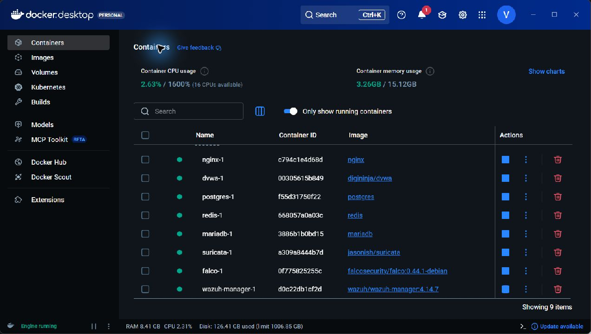
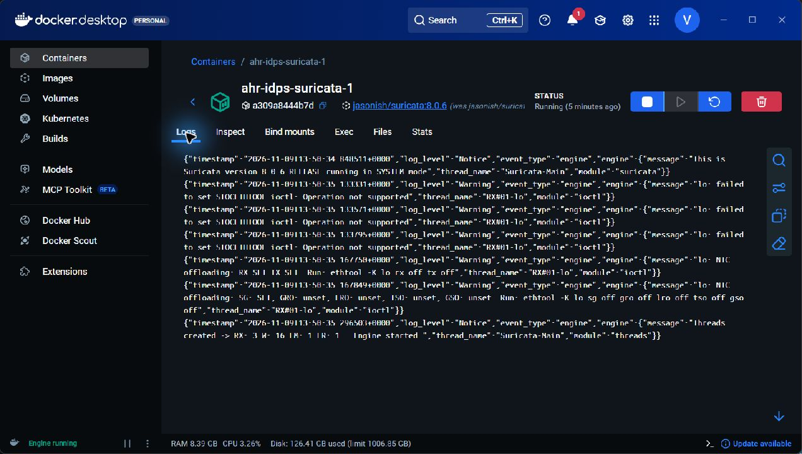
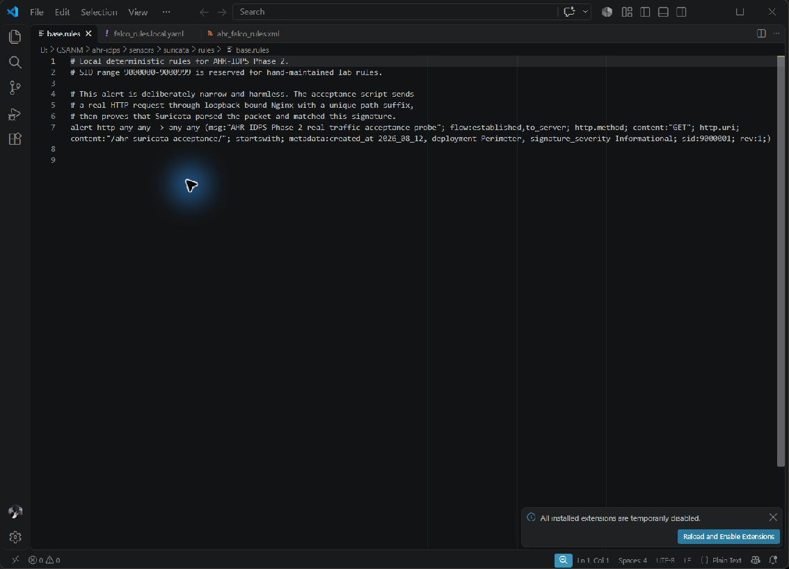
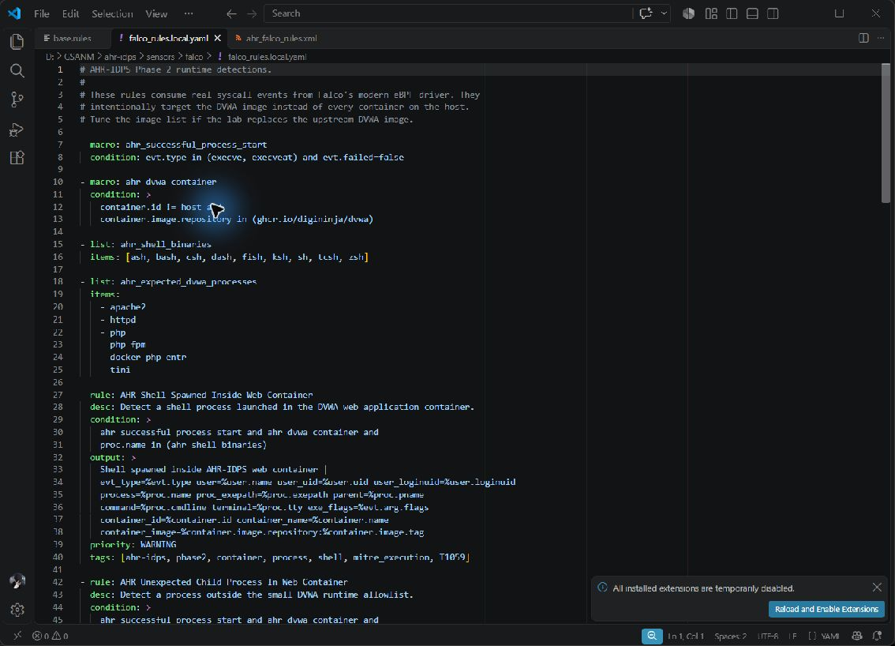
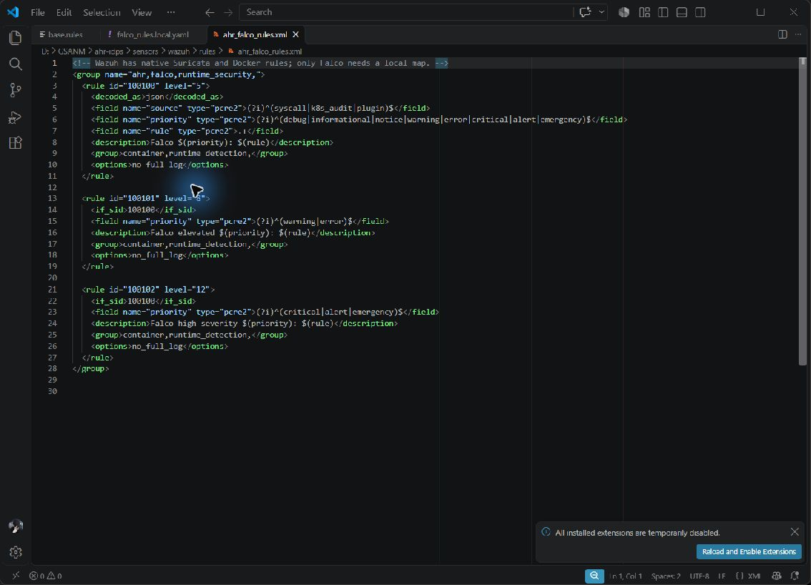

# Khởi tạo Suricata Falco và Wazuh

**Khởi tạo cảm biến và phân loại các quy tắc có sẵn**

Một cảm biến ở trạng thái chạy không đồng nghĩa đã có đầy đủ luật phát hiện cho mọi loại tấn công. Cấu hình khởi tạo phải chỉ ra image nào được sử dụng, file nào được nạp, luật đến từ nhà cung cấp hay từ đề tài, nguồn sự kiện đầu vào và nơi ghi kết quả. Phần kiểm kê này được thực hiện trực tiếp trên các container của AHR-IDPS ngày 09/11/2026; ảnh Docker Desktop và các file cấu hình được chụp trong cùng phiên. Những giá trị đếm dưới đây chỉ áp dụng cho image và cấu hình của lần kiểm tra này.

Thứ tự khởi tạo bắt đầu từ MariaDB, PostgreSQL và Redis, tiếp theo là DVWA cùng Nginx. Suricata cần namespace mạng của Nginx; Falco cần quyền quan sát runtime Linux và metadata container. Hai cảm biến tạo file đầu ra trên named volume trước khi Wazuh bắt đầu đọc. Wazuh sau đó nạp decoder, luật chuẩn và ánh xạ Falco riêng. Các container được kiểm tra health, đồng thời đối chiếu file luật với cấu hình để tránh nhầm giữa “file tồn tại” và “engine đã nạp”.

| Thành phần | Bộ quy tắc kiểm kê khi khởi tạo | Ý nghĩa và giới hạn |
|---|---|---|
| Suricata 8.0.6 | Runtime báo 1 luật nạp, 0 lỗi, 0 bỏ qua; base.rules có 1 luật; generated.rules và shadow.rules đều 0 | Luật nền là probe xác nhận quan sát HTTP, chưa phải bộ chữ ký tấn công diện rộng |
| Falco 0.44.1 | File chuẩn có 25 định nghĩa rule, 87 macro, 49 list; AHR bổ sung 6 rule, 2 macro, 2 list; falco -L báo 31 rule enabled | Đây là số định nghĩa trong file, không tự tương đương tổng số rule đang bật sau mọi override |
| Wazuh Manager 4.14.7 | 168 file XML chuẩn, 4.512 định nghĩa rule; một file policy có 2 định nghĩa bị cấu hình loại trừ; AHR bổ sung 3 rule Falco; local_rules.xml còn 1 rule mẫu SSH | Không lấy 4.512 làm số luật hoạt động; cần xét rule_exclude, dependency và mức cảnh báo |

**Suricata khởi tạo chế độ IDS mạng**

Image Suricata được cố định bằng digest. Container dùng network_mode theo dịch vụ Nginx để quan sát traffic đi tới gateway và traffic từ gateway sang DVWA. Entrypoint tạo các thư mục ghi log và socket điều khiển, thiết lập quyền, sau đó chạy engine với cấu hình được mount chỉ đọc. File suricata.yaml đặt host-mode là sniffer-only và lệnh khởi động chọn PCAP; cơ chế hiện tại quan sát và phát alert, không phải đường NFQUEUE inline để tự drop gói tin.

Danh sách rule-files chỉ gồm base.rules, generated.rules và shadow.rules. Luật nền có SID 9000001, hành động alert, giao thức HTTP, hướng established/to_server, method GET và URI bắt đầu bằng /ahr-suricata-acceptance/. Đây là probe không gây hại nhằm xác nhận engine thực sự nhìn thấy request qua Nginx. Luật này không chứng minh khả năng nhận diện SQL injection, XSS hay một họ tấn công cụ thể. Không có căn cứ từ cấu hình hiện tại để khẳng định đã nạp Emerging Threats hoặc một bộ chữ ký cộng đồng lớn.

Lệnh ruleset-stats qua socket điều khiển trả rules_loaded = 1, rules_failed = 0 và rules_skipped = 0. Hai file generated.rules và shadow.rules chỉ có chú thích, không có dòng rule hoạt động. Việc giữ sẵn file rỗng tạo điểm gắn cấu hình, không có nghĩa AI đã sinh hoặc triển khai luật. Trong kiến trúc GenTI hiện tại, candidate và trạng thái Shadow/Active còn được quản lý tại backend và registry; không được lấy trạng thái trên dashboard để suy ra sensor đã reload file generated.rules.

EVE JSON được ghi trên volume suricata_logs để Collector và Wazuh đọc. Healthcheck kết hợp sự tồn tại của eve.json với phản hồi uptime từ socket Suricata. Log khởi động ghi Engine started; đồng thời có cảnh báo offloading trên loopback trong môi trường WSL. Các cảnh báo này phải được giữ trong bằng chứng, không xóa khỏi ảnh để tạo cảm giác engine hoàn toàn không có cảnh báo. Việc engine lên healthy xác nhận bước khởi tạo, chưa thay cho replay có nhãn hoặc đo tỷ lệ phát hiện.

**Falco khởi tạo giám sát runtime và bộ luật cho DVWA**

Falco sử dụng modern_ebpf, quan sát syscall của kernel Linux phía Docker/WSL và dùng plugin container để bổ sung metadata. Cấu hình AHR bật JSON output, ghi stdout và events.jsonl, đặt mức priority tối thiểu debug, bật rule_matching: all và health endpoint tại 127.0.0.1:8765. Chế độ all cho phép một syscall thỏa nhiều luật, thay vì một luật chuẩn che mất kết quả luật riêng của đề tài. Điều kiện quan sát vẫn phụ thuộc kernel, khả năng nạp BPF và quyền được cấp cho container.

Log khởi động xác nhận thứ tự file luật gồm falco_rules.yaml, falco_rules.local.yaml, rules.d/90-ahr-idps.yaml và rules.d/99-generated-rules.yaml. Trong image đang dùng, file chuẩn có 25 định nghĩa rule; file local chuẩn không thêm rule. File 90-ahr-idps.yaml được mount từ falco_rules.local.yaml của dự án, chứa sáu luật bên dưới. File generated hiện là danh sách YAML rỗng, vì vậy chưa bổ sung rule do quá trình sinh tự động. Kiểm tra bổ sung bằng falco -L với cùng cấu hình trả 31 rule có enabled=true, trong đó có đủ sáu rule AHR. Kết quả này xác nhận trạng thái bật trong cấu hình được biên dịch, không thay cho kiểm chứng mọi hành vi runtime. Không cộng macro và list vào số luật phát hiện; chúng chỉ là thành phần tái sử dụng trong điều kiện.

| Luật riêng của AHR-IDPS | Điều kiện trọng tâm | Mức cảnh báo |
|---|---|---|
| AHR Shell Spawned Inside Web Container | Process khởi chạy thành công và tên shell thuộc danh sách theo dõi trong container DVWA | WARNING |
| AHR Unexpected Child Process In Web Container | Process nằm ngoài allowlist runtime và ngoài nhóm shell đã theo dõi riêng | WARNING |
| AHR Suspicious Executable In Web Container | Thực thi từ /tmp, /var/tmp hoặc /dev/shm | ERROR |
| AHR Sensitive Path Write In Web Container | Mở ghi thành công vào đường dẫn hệ thống nhạy cảm | ERROR |
| AHR Unexpected Outbound Connection From Web Container | Kết nối ra ngoài, trừ đường Apache tới MariaDB cổng 3306 đã cho phép | WARNING |
| AHR Privilege Activity In Web Container | Thay đổi identity, capability, namespace hoặc bit setuid/setgid | ERROR |

Các luật AHR giới hạn theo repository image ghcr.io/digininja/dvwa và container.id khác host. Điều kiện này giảm nhiễu từ các dịch vụ còn lại nhưng cũng giới hạn phạm vi: khi đổi image web, phải rà lại macro, không mặc định mọi container mới đều được bao phủ. Một shell khởi chạy do thao tác quản trị hợp lệ vẫn có thể thỏa điều kiện; cảnh báo Falco cần được đọc cùng process, parent, command và bối cảnh phiên. Trong cấu hình này Falco phát hiện và ghi evidence, không tự chặn hay cô lập container.

**Wazuh khởi tạo SIEM và ánh xạ luật cảm biến**

Wazuh chạy topology manager-only. Cấu hình ossec.conf bật JSON alerts, nhận log EVE của Suricata và events.jsonl của Falco trên volume dùng chung, đồng thời bật Docker listener. Decoder chuẩn được lấy từ ruleset/decoders, rule chuẩn từ ruleset/rules; thư mục etc/decoders và etc/rules dành cho mở rộng của dự án. Kiểm tra wazuh-analysisd -t kết thúc thành công, và các tiến trình analysisd, logcollector, remoted, modulesd, authd cùng database được healthcheck theo dõi.

Kiểm kê file XML đã loại phần comment cho thấy 168 file chuẩn chứa 4.512 định nghĩa rule. Cấu hình loại trừ 0215-policy_rules.xml, file này có hai định nghĩa. Con số kiểm kê phản ánh nội dung được phân phối trong image, không phải kết quả đếm tập rule cuối cùng đã bật. Thư mục etc/rules còn có local_rules.xml đi kèm image, chứa rule ví dụ 100001 level 5, kế thừa 5716 và chỉ khớp lỗi xác thực SSH từ địa chỉ mẫu 1.1.1.1. Đây là ví dụ cấu hình mặc định, không phải luật tổng quát phát hiện mọi brute force và không phải sản phẩm GenTI. Các rule level 0 còn có thể đóng vai trò phân loại hoặc cha cho rule con; không nên xem mỗi rule là một loại tấn công độc lập hay một cảnh báo mức cao.

Wazuh có sẵn nhóm Suricata trong 0475-suricata_rules.xml: 86600 ở level 0 phân loại thông điệp JSON, 86601 ở level 3 nhận event_type alert, còn 86602–86604 xử lý HTTP, DNS và TLS ở level 0. Nhóm Docker nằm trong các file 0455-docker_rules.xml và 0560-docker_integration_rules.xml. Đây là logic SIEM xử lý sự kiện do nguồn khác cung cấp, không phải chữ ký payload mà Wazuh trực tiếp áp lên gói mạng. Cũng không được cộng số rule Wazuh vào số signature Suricata để tính độ bao phủ tấn công.

Phần riêng của đề tài là ahr_falco_rules.xml, gồm rule 100100 level 5 nhận JSON Falco có source, priority và tên rule hợp lệ; rule 100101 level 8 kế thừa 100100 khi priority là warning hoặc error; rule 100102 level 12 kế thừa khi priority là critical, alert hoặc emergency. Các rule này ánh xạ cảnh báo runtime vào phân cấp SIEM và giữ liên hệ với tên luật Falco. Chúng được khai báo thủ công trong cấu hình khởi tạo, không phải đầu ra của GenTI.

Cổng 1514 phục vụ nhận sự kiện agent và 1515 phục vụ enrollment, đều giới hạn loopback của máy. API Wazuh là dịch vụ HTTPS cổng 55000, chỉ được publish khi ghép thêm compose.api.fragment.yml bằng script start_wazuh_api.sh. Trong phiên kiểm tra, overlay API đã được ghép, cổng 55000 publish trên loopback và truy vấn HTTPS không kèm xác thực nhận HTTP 401. Kết quả xác nhận API có phản hồi và yêu cầu xác thực; không có token hay mật khẩu được đưa vào ảnh. Đây là API quản lý, không phải giao diện Wazuh Dashboard. Topology hiện tại không khởi tạo indexer và Wazuh Dashboard; màn hình SOC của đề tài là dashboard riêng do backend AHR-IDPS cung cấp.

Một số chức năng như rootcheck, FIM/syscheck, SCA, syscollector và vulnerability detection được cấu hình tắt trong manager-only lab. Không được mô tả chúng đã giám sát đầy đủ chỉ vì tiến trình container đang chạy. Tương tự, đăng ký agent có cơ chế mật khẩu riêng nhưng giá trị bí mật không xuất hiện trong ảnh hay báo cáo.

**Phân biệt luật khởi tạo và quy tắc do AI tạo**

Luật chuẩn đi cùng image là điểm xuất phát của nhà cung cấp; luật AHR là cấu hình riêng được người xây dựng hệ thống viết và mount vào cảm biến; candidate GenTI là kết quả của model fine-tune, có model hash, yêu cầu, evidence và receipt riêng. Ba nguồn này cần được thể hiện tách biệt khi báo cáo kết quả. Số lượng rule có sẵn không phải số rule AI đã sinh, và số rule AI đã sinh không phải số rule đang có hiệu lực chặn.

Phiên kiểm tra khởi tạo này chỉ bật hạ tầng lab và ba cảm biến để đọc trạng thái, file luật và log. Chưa bật lại mô hình GenTI, worker tự động hoặc thực hiện một lượt tấn công mới để đo DR/FPR. Vì vậy, các ảnh khởi tạo chứng minh cấu hình và trạng thái khởi tạo tại thời điểm chụp, không được dùng thay cho bằng chứng sinh rule hoặc chặn một cuộc tấn công mới.

