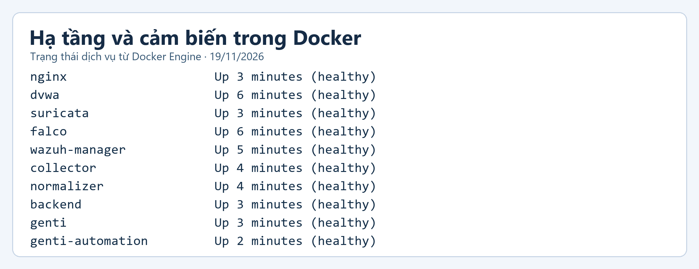
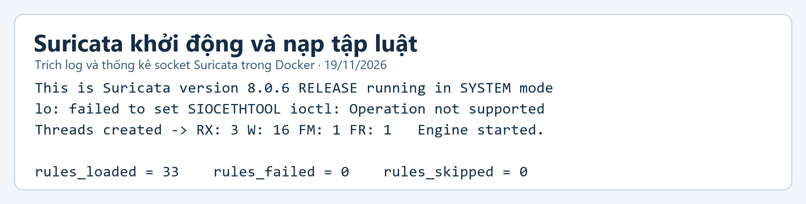
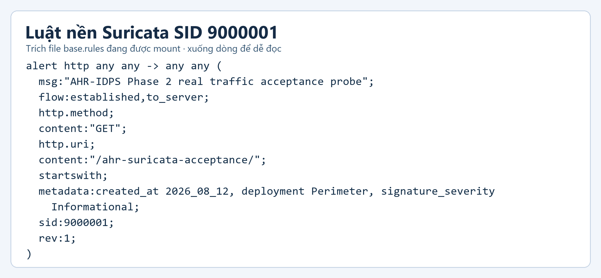
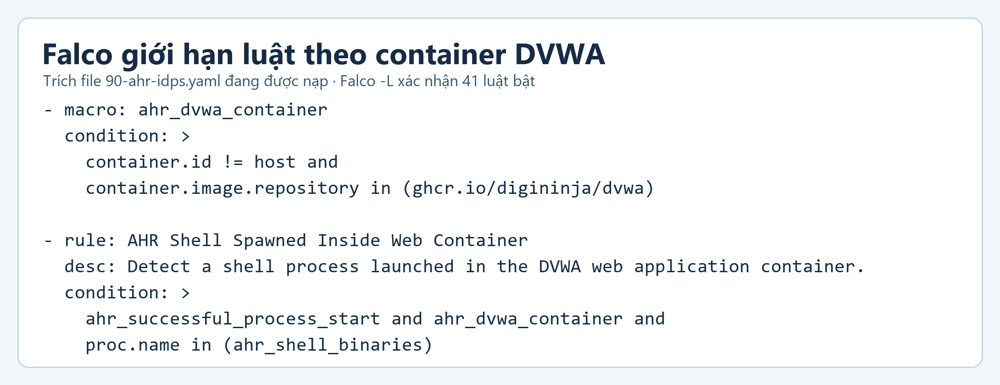
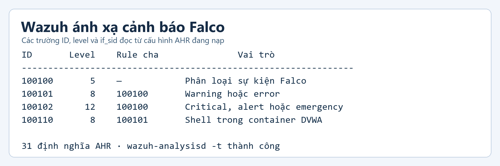

# Khởi tạo Suricata Falco và Wazuh

Kết quả dưới đây được đối chiếu trên Docker ngày 19/11/2026. MariaDB, PostgreSQL và Redis khởi động trước luồng xử lý. Suricata quan sát lưu lượng ở namespace mạng của Nginx. Falco thu sự kiện runtime Linux bằng modern eBPF. Wazuh Manager đọc log cảm biến và áp dụng các luật phân loại, ánh xạ và tương quan.

| Cảm biến | Kết quả đối chiếu | Nguồn kiểm tra |
| --- | --- | --- |
| Suricata 8.0.6 | 33 luật nạp, 0 lỗi, 0 bị bỏ qua. Gồm SID kiểm tra đường thu nhận và 32 chữ ký web AHR. | Socket Suricata, file luật đang mount và log khởi động |
| Falco 0.44.1 | 41 luật bật, gồm 25 luật chuẩn và 16 luật AHR. Macro và list được đếm riêng. | Danh sách biên dịch từ `falco -L` |
| Wazuh Manager 4.14.7 | 31 định nghĩa luật AHR, ID duy nhất. Cấu hình qua kiểm tra. | File `ahr_falco_rules.xml` trong container và `wazuh-analysisd -t` |

Cảnh báo từ các luật nền được gửi vào hệ thống thu nhận. GenTI sinh Candidate có biên nhận riêng. AHR-IDPS thực thi chặn HTTP tại Nginx theo quy tắc còn đủ điều kiện. Danh mục ID và các phép kiểm trước đó nằm ở [Bộ luật nền](BASELINE_RULES.md).

Wazuh chạy ở cấu hình manager-only. Cổng 55000 là API quản lý HTTPS, được publish trên loopback khi dùng overlay API. Dashboard SOC của đề tài được phục vụ riêng.

