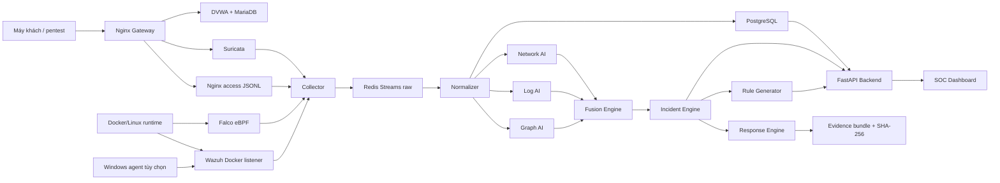

# AHR-IDPS: chức năng node, giao diện quản trị và quy trình giám sát

## 1. Luồng vận hành chính



Quy tắc đọc sơ đồ: dữ liệu đi từ trái sang phải; các node AI chỉ chấm điểm và
bổ sung ngữ cảnh; quyết định containment đi qua `Incident Engine` và chính sách
`Response Engine`. Chế độ mặc định là `alert_only`, nên một điểm AI đơn lẻ
không được tự block hoặc isolate container.

## 2. Chức năng của từng node

| Node | Chức năng chính | Dữ liệu vào | Dữ liệu ra / người dùng hưởng lợi |
| --- | --- | --- | --- |
| Máy khách / pentest | Gửi request benign hoặc scenario được ủy quyền; thêm `ahr_scenario` để truy vết | HTTP tới loopback | Traffic và marker để kiểm thử |
| Nginx Gateway | Điểm vào duy nhất; route DVWA, API và dashboard; tạo `trace_id` | Request client | Response ứng dụng + access JSONL |
| DVWA | Ứng dụng web có lỗ hổng cố ý để tạo tín hiệu kiểm thử | Request qua Nginx | HTTP status, body và hành vi lỗ hổng |
| MariaDB | CSDL của DVWA | Query từ DVWA | Dữ liệu ứng dụng trong mạng nội bộ |
| Docker/Linux runtime | Cung cấp process, syscall, file và lifecycle container | Hoạt động container | Góc nhìn runtime cho Falco/Wazuh |
| Suricata NIDS | Phân tích packet/flow và signature HTTP/DNS/TLS | Traffic trong namespace Nginx | EVE JSON: `alert`, `http`, `flow`, `dns`, `tls` |
| Nginx access log | Ghi request ở lớp ứng dụng | Request/response proxy | Method, URI, status, latency, upstream, trace ID |
| Falco/eBPF | Phát hiện shell, child process, file nhạy cảm, kết nối và privilege activity | Linux syscall | Falco JSONL, rule, priority, process/container fields |
| Wazuh Manager | Chuẩn hóa và phát alert từ Suricata, Falco, Docker và Windows agent | EVE/JSONL, Docker event, agent event | `alerts.json`, rule ID, severity, decoder |
| Windows Wazuh Agent | Thu Windows Security/System/Application log tùy chọn | Windows event log | Event về Wazuh manager qua loopback 1514/1515 |
| Collector | Tail các file log, chống đọc lặp, lưu checkpoint | Suricata/Falco/Wazuh/Nginx logs | Raw event vào Redis stream |
| Redis Streams | Event bus giữa các consumer | Raw và các stream trung gian | `security.events.raw`, normalized, predictions, incidents, rules, responses |
| Normalizer | Đưa event về schema chung, deduplicate, quarantine bản ghi lỗi | Raw event | Normalized event + severity/category/entity |
| PostgreSQL | Lưu dữ liệu bền vững và provenance | Normalized event, AI result, incident, rule | Query cho API, dashboard, evidence và nghiên cứu |
| Dataset/Model Registry | Ghi scenario, label, split, model version và metric | Event/label/model artifact | Tái lập train/evaluate và so sánh E1–E9 |
| Network AI | XGBoost trên feature flow/cửa sổ mạng | Normalized network event | `network_score`, anomaly/classification |
| Log AI | Làm sạch log, embedding và anomaly/classifier | Normalized log event | `log_score`, representation và prediction |
| Graph AI | Xây graph entity/process/container/network theo session | Event window và edge | `graph_score`, node/edge explanation |
| Fusion Engine | Kết hợp rule + 3 AI + context; renormalize score khi thiếu nguồn | Rule score, network/log/graph score | `fusion_score`, risk level, breakdown |
| Incident Engine | Sessionize, correlate nhiều event và xây timeline/attack graph | Normalized event + prediction | Incident, attack chain, evidence event list |
| Rule Generator | Khai phá pattern lặp và tạo candidate rule | Event/incident/pattern | Rule `candidate`, validation metrics; SHADOW trước ACTIVE |
| FastAPI Backend | API REST và WebSocket cho vận hành | PostgreSQL, Redis, health registry | `/api/*`, `/ws/*` cho giao diện và tích hợp |
| SOC Dashboard | Màn hình thao tác và điều tra | API/WebSocket | Overview, live events, alerts, incidents, graph, AI, rules, responses |
| Response Engine | Áp chính sách phản ứng có điều kiện, TTL, rollback và audit | Incident/risk/policy | Alert, lab block/isolation được allowlist, response record |
| Evidence Bundle | Đóng gói bằng chứng điều tra | Raw events, timeline, process tree, metadata | Manifest và SHA-256 để bàn giao/retest |

## 3. Giao diện quản trị và việc cần làm ở từng màn hình

| Màn hình | Câu hỏi vận hành | API/WebSocket chính |
| --- | --- | --- |
| Overview | Hệ thống có đang thu dữ liệu và có cảnh báo nghiêm trọng không? | `/api/dashboard/overview`, `/api/sensors` |
| Live events | Event mới nhất đến từ sensor nào, marker nào? | `/api/events`, `/ws/events` |
| Alerts | Rule nào đang tạo nhiều alert, severity nào cần ưu tiên? | `/api/alerts`, `/ws/alerts` |
| Incidents | Nhiều event có cùng thuộc một chuỗi tấn công không? | `/api/incidents/{id}`, `/ws/incidents` |
| Attack Graph | Process nào sinh process nào, entity nào liên quan? | Chi tiết `attack_graph` trong incident |
| Network | Flow, protocol, source/destination và Suricata alert ra sao? | `/api/network/summary` |
| Containers | Container nào có Falco alert/risk cao? | `/api/containers` |
| AI Monitor | Các model đang active, precision/recall/FPR/latency thế nào? | `/api/models` |
| Generated rules | Candidate rule đã qua validation/SHADOW/approval chưa? | `/api/rules?source=generated` |
| Responses | Đã phản ứng gì, hết hạn chưa, rollback được không? | `/api/responses` |
| Experiments | E1–E9 và unknown attack before/after thay đổi thế nào? | `/api/experiments`, `POST /api/experiments/run` |
| System Health | Backend, DB, Redis và sensor có còn sống/fresh không? | `/api/system/health`, `/ws/system` |
| Sensors | Lần cuối từng source gửi event lúc nào? | `/api/sensors` |

Health API là chỉ báo tổng hợp. Khi điều tra, đối chiếu thêm `docker compose ps`
và `last_event_at`; heartbeat cũ có thể làm sensor trông như đang `reporting`
sau khi process đã dừng.

## 5. Kết quả kiểm thử giao diện và cổng ngày 10/09/2026

Lệnh kiểm thử:

```powershell
.\scripts\interface_acceptance.ps1
```

Kết quả thực tế:

- `127.0.0.1:8080` mở; `/`, `/dashboard/`, `/healthz` và các API dashboard đều
  trả HTTP 200.
- Dashboard bundle có đủ các màn hình Overview, Live events, Alerts, Incidents,
  Attack Graph, Network, Containers, AI Monitor, Generated rules, Responses,
  Experiments, System Health và Sensor health.
- `127.0.0.1:1514` và `127.0.0.1:1515` mở cho Wazuh agent transport/enrollment.
- Backend port `8000`, MariaDB `3306` và Redis `6379` không publish ra host.
- Compose không publish PostgreSQL `5432`, nhưng máy Windows đang có một tiến
  trình PostgreSQL riêng lắng nghe `0.0.0.0:5432`; đây không phải mapping của
  AHR-IDPS. Cần dừng hoặc giới hạn tiến trình đó nếu máy lab phải kín tuyệt đối.

Kiểm tra khả năng sử dụng:

- DVWA login `admin/password`: PASS.
- WebSocket `/ws/system`: PASS, nhận `{"redis":true,"backend":"up"}`.
- WebSocket `/ws/events` và `/ws/alerts`: PASS, nhận normalized event thật.
- WebSocket `/ws/incidents`: PASS, nhận danh sách incident đã serialize dạng
  ISO-8601; lỗi session factory và datetime serialization đã được sửa trong
  backend.
- Scenario `pentest_login_20260910`: 9 request sau login, 54 event và 6 alert
  chứa marker khi truy vấn API.

Redis của lab được giới hạn 1 GB để có đủ headroom cho background RDB/AOF
rewrite khi event stream lớn; giới hạn 512 MB trước đây gây OOM và làm API/
WebSocket mất kết nối.


## 4. Quy trình giám sát một ca trực

1. Kiểm tra `System Health`, `Sensor Health` và trạng thái container.
2. Kiểm tra freshness của Suricata, Falco, Wazuh, Nginx, collector và normalizer.
3. Xem `Live events` để phát hiện spike, event lặp hoặc source mất dữ liệu.
4. Mở `Alerts`, ưu tiên severity cao, nhiều rule hoặc nhiều sensor cùng match.
5. Mở incident tương ứng, đọc timeline và attack graph.
6. So sánh `rule_score`, `network_score`, `log_score`, `graph_score` và
   `fusion_score`; ghi rõ score nào bị thiếu.
7. Xác minh raw event trong named volume trước khi kết luận true positive.
8. Ghi `expected test` nếu event đến từ pentest có `ahr_scenario`.
9. Chỉ chuyển sang containment khi policy cho phép; mặc định giữ `alert_only`.
10. Xuất evidence bundle và checksum khi incident cần bàn giao hoặc retest.
