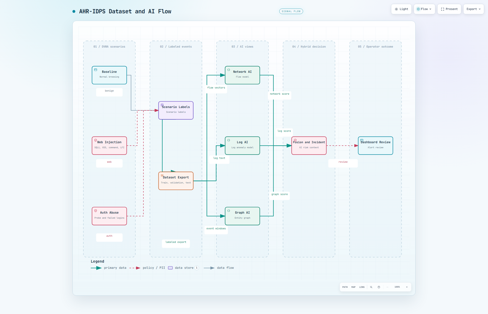

# Dataset va training cho DVWA

## Muc tieu dataset



Dataset cua AHR-IDPS khong la ban sao request DVWA. Moi mau la mot security
event da duoc collector va normalizer chuan hoa tu Nginx, Suricata, Falco hoac
Wazuh. Mot scenario co `scenario_id`; event co marker cua scenario trong khoang
thoi gian thu thap se nhan label `benign` hoac `attack` trong bang
`ahr.event_labels`.

Mot request DVWA co the tao nhieu event: Nginx ghi access log, Suricata ghi HTTP
va flow, Wazuh co the tao alert, command injection co them Falco runtime event.
Vi vay can danh gia theo scenario va attack type, khong chi dem request HTTP.

## Ba nhom du lieu phu hop

| Nhom | Label | Noi dung | Muc dich |
| --- | --- | --- | --- |
| Baseline | `benign` | Login, xem trang DVWA, thay doi security level, logout, truy cap instructions/about | Hoc traffic va log hop le |
| Web injection | `attack` | SQLi, reflected XSS, command injection, file inclusion | Hoc URI, query, alert, process va relation runtime |
| Auth abuse | `attack` | Path probe va ba lan login sai co gioi han | Hoc tan suat, sequence va pattern xac thuc |

Khi thuc hien thu thach DVWA, giu mot `scenario_id` rieng cho moi lan chay. Khong
tron event cua nhieu scenario vao mot nhan chung chung.

## Quy mo de xuat cho may lab

Bat dau voi 60 scenario doc lap, khong can tao dataset qua lon:

| Nhom | So scenario | Lap lai moi scenario | Muc tieu event da gan nhan |
| --- | ---: | ---: | ---: |
| Baseline | 25 | 2-3 | 800-1200 |
| Web injection | 20 | 2 | 800-1200 |
| Auth abuse | 15 | 2 | 500-800 |

Tong 2.100-3.200 event da gan nhan la du de demo trong bai tap lon. So luong
event cua moi scenario se khac nhau theo sensor; uu tien giu can bang nhom
benign va attack hon la tao rat nhieu request giong nhau.

De danh gia dung, chia theo `scenario_id`, khong chia ngau nhien tung event.
Ty le de xuat la 60% train, 15% validation, 15% known test va 10% unknown test.
Unknown test phai giu lai mot attack type hoac bien the chua dung trong train.
Vi du: train SQLi, XSS va auth abuse; giu file inclusion hoac payload SQLi bien
the cho unknown test.

## Dataset ngoai de tai ve

Dataset ngoai phu hop nhat de bo sung cho Network AI la **CIC-IDS2017** cua
Canadian Institute for Cybersecurity:

`https://www.unb.ca/cic/datasets/ids-2017.html`

Tai cac CSV/PCAP co nhan **Web Attack - Brute Force**, **Web Attack - XSS**,
**Web Attack - Sql Injection** va benign flow. Ba nhan web attack nay gan voi
ba bai thu thach DVWA hon cac dataset IDS tong quat.

Khong dua thang cot CSV cua CIC-IDS2017 vao model AHR-IDPS hien tai. Truoc khi
train, can map flow ve schema event cua AHR-IDPS va giu label provenance. Dataset
ngoai bo sung da dang network flow; dataset DVWA local van can thiet cho Log AI
va Graph AI vi CIC-IDS2017 khong co Falco syscall, Wazuh alert, container va
process relation cua lab.

## Thu thap du lieu co label

Chay core, sensor, pipeline va backend truoc. Sau do dung script collection:

```powershell
powershell -ExecutionPolicy Bypass -File .\scripts\collect_dvwa_training_dataset.ps1 -Profile all
```

Script chay traffic ben trong network `nginx`, tao scenario run trong PostgreSQL,
gan label va export dataset vao `datasets/`. Dung `-Profile baseline`,
`-Profile web_injection` hoac `-Profile auth_abuse` de thu tung nhom.

Khi muon tu lam bai thu thach DVWA bang trinh duyet, dung script sau de tao
traffic co login va marker:

```powershell
python .\scripts\authorized_monitoring_scenarios.py --target http://127.0.0.1:8080 --scenario web_injection --scenario-id challenge_web_001
```

Traffic nay hien tren dashboard ngay. De dua vao dataset train, chay collection
script hoac tao `scenario_run` va label tuong ung; khong coi event chua label la
mau train.

## Cach model train

`Network AI` dung XGBoost tren feature event/flow: port, protocol, source/dest,
severity, HTTP/flow flag, byte/packet, error rate va feature cua cua so traffic.
Nhan la `attack=1`, `benign=0` tu `ahr.event_labels`.

`Log AI` chuyen event Nginx, Suricata, Falco va Wazuh thanh text chuan hoa, tao
embedding 384 chieu, sau do dung IsolationForest va MLP classifier. Model nay
phu hop voi log/message bat thuong, khong thay the network feature.

`Graph AI` gom event trong cua so 30 giay thanh do thi IP, container, process,
file va rule. Mot graph mang nhan attack khi co it nhat mot event attack trong
cua so do.

`Fusion AI` dung rule score, ba score AI, context severity va event density de
tinh risk cuoi. Fusion phai chay sau khi cac model con lai da co prediction.

## Train va kiem tra

Sau khi co du label, chay:

```powershell
powershell -ExecutionPolicy Bypass -File .\scripts\train_dvwa_models.ps1
```

Script train lan luot network, log, graph va fusion; moi model duoc dang ky lai
vao PostgreSQL. Sau do bat realtime AI:

```powershell
powershell -ExecutionPolicy Bypass -File .\scripts\start_ai.ps1
```

Doc ket qua trong Dashboard > Dieu tra > AI Monitor. So sanh precision, recall,
F1, FPR va do tre. Neu baseline bao dong qua nhieu, thu them scenario benign
thuc te; neu attack bi bo sot, thu them bien the cua attack do nhung giu mot
phan bien the cho unknown test.
